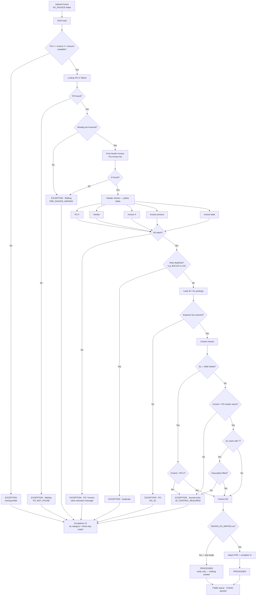

# Vendor Invoice Verify — End-to-end flow

Rohrman · `PO_INVOICE` path (Miscellaneous / Stock / Sublet).  
**No PO create, no pre-invoice** — verify against Tekion only; attach & complete only when `TEKION_PO_WRITES` is on.

## Header fields verified (Vendor Invoice screen)

- PO Number  
- Vendor Number / Name  
- Invoice Number (full, including letters/suffixes)  
- Invoice Amount (to the cent)  
- Invoice Date  

## Journal Entry — Control rules

- Most expense GLs: **Control = PO vendor name**  
- Sublet GL **2460**: **Control = Repair Order #**  
- GLs starting with **7**: also need a **Description**  

---

Also available as a browser file: [`vi-verify-flow.html`](./vi-verify-flow.html) (open in Chrome/Edge to see the diagram).
